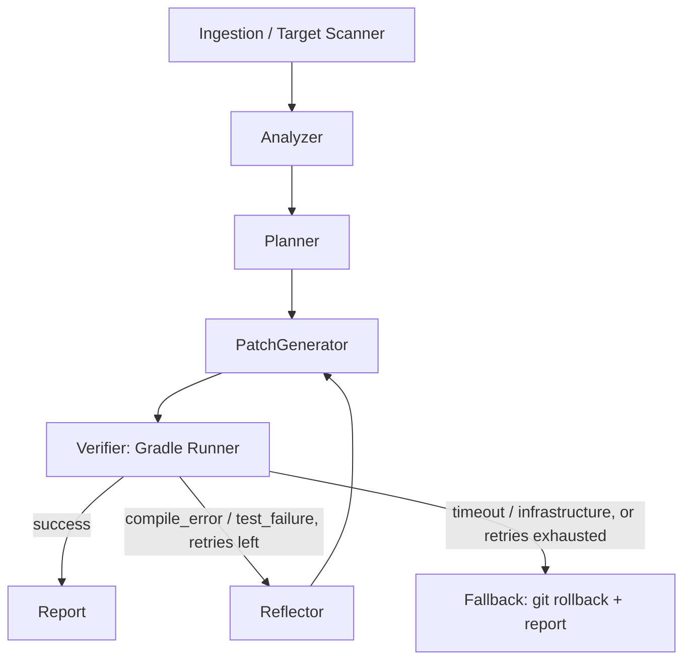

# GradleHealer

Autonomous Python agent built on LangGraph. It analyzes legacy Kotlin/Android code, generates unit tests (MockK, kotlinx-coroutines-test, Turbine) and performs refactorings with self-healing verified through Gradle.

## Core principle

**Generation is probabilistic, verification is deterministic.**
The agent does not infer the outcome of a build: it delegates it to the real compiler and Gradle. Every LLM output remains a hypothesis until `./gradlew` returns exit code 0.

## Stack

- **Runtime**: Python 3.12+, asynchronous (`asyncio`). Subprocesses use the low-level `loop.subprocess_exec` with a `SubprocessProtocol`, not `asyncio.create_subprocess_exec`: `Process.wait()` resolves only after every pipe has closed, so a descendant that inherited the pipes (e.g. a Kotlin daemon) would hang it although the child has exited. The protocol reports exit and pipe EOF separately.
- **Agent**: LangGraph (`StateGraph`, conditional edges, reflection loop, checkpointing), from Sprint 2
- **Contracts**: Pydantic V2 for typed payloads and validated structured output
- **Target**: multi-module Android/Kotlin projects with Gradle (Kotlin DSL)
- **Observability**: Langfuse (per-node tracing, token usage, pass@k), from Sprint 4
- **Quality**: `uv`, Ruff (lint + format), mypy strict, pytest + pytest-asyncio, pre-commit, GitHub Actions
- **Platform**: Linux only, tested in CI (process groups via `os.killpg`). macOS is not verified yet and Windows is not supported yet (both Sprint 1.5); WSL2 works as Linux.

## Structure

```text
gradle-healer/
├── AGENTS.md
├── CLAUDE.md                # imports AGENTS.md
├── README.md                # user-facing
├── CONTRIBUTING.md          # development setup, branching and releases
├── CHANGELOG.md             # Keep a Changelog
├── LICENSE                  # proprietary
├── pyproject.toml
├── .pre-commit-config.yaml
├── .github/workflows/ci.yml # checks on every push; integration on PRs to main
├── src/gradle_healer/
│   ├── core/
│   │   ├── schemas.py       # BuildResult, TargetClassContext, CodePatchPlan
│   │   ├── validation.py    # CodePatchPlan vs TargetClassContext cross-checks
│   │   ├── state.py         # (Sprint 2) AgentState
│   │   └── config.py        # (Sprint 2)
│   ├── tools/
│   │   ├── gradle_runner.py # async process runner -> RunOutcome
│   │   ├── log_parser.py    # RunOutcome -> BuildResult (pure)
│   │   ├── build_check.py   # runner + parser glue
│   │   └── git_helpers.py   # (Sprint 3) targeted rollback
│   ├── graph/               # (Sprint 2) nodes, routing, graph builder
│   ├── prompts/             # (Sprint 2) versioned prompt templates
│   └── cli.py               # (Sprint 4) Typer entry point
├── tests/                   # offline unit tests (fakes/fixtures)
│   ├── core/
│   ├── tools/               # sandbox.py: helpers for real-Gradle tests
│   └── fixtures/logs/       # recorded Gradle stdout/stderr per scenario
└── evals/
    ├── fixtures/sandbox-jvm/ # Kotlin/JVM Gradle project, green by default
    ├── fixtures/scenarios/   # test files that break the sandbox on purpose
    └── run_benchmark.py      # (Sprint 4)
```

## Graph



1. **Ingestion**: locates the target class, the Gradle module it belongs to and its source sets.
2. **Analyzer**: extracts signatures, constructors, injected dependencies, coroutines/Flows and produces the minimal semantic context as a `TargetClassContext`. The parser is tree-sitter-kotlin (Sprint 2); `TargetClassContext` is parser-agnostic and describes the class, not the tool that extracted it.
3. **Planner**: produces a `CodePatchPlan` as LLM structured output. Its JSON Schema must stay portable across structured-output APIs: native types only, no `Field` constraints, no defaults (every field required); every rule lives in a validator and is stated in the field description. Before any code generation, `core/validation.py` cross-checks the plan against the `TargetClassContext` and returns `PlanIssue`s the Planner can be retried with.
4. **PatchGenerator**: generates the Kotlin code and writes whole test files into the module's test source set, resolved from the module configuration rather than hardcoded (`src/test/kotlin` or `src/test/java`). It never overwrites an existing test file (`PlanIssueCode.WOULD_OVERWRITE_EXISTING_TESTS`).
5. **Verifier**: runs `gradlew <task> --console=plain --no-daemon` plus optional extra args (e.g. `--stacktrace`) in an async subprocess. `gradle_runner` returns a raw `RunOutcome` (exit code, timeout, sanitized stdout/stderr); `log_parser` turns it into a `BuildResult`; `build_check.check_build` glues the two.
   - Android module: `:<module>:testDebugUnitTest`
   - Pure JVM module: `:<module>:test`
   - The task must therefore be parameterized, not hardcoded.
6. **Routing**: on `BuildResult.failure_kind`, never on the raw exit code (compile errors and test failures both exit with 1).
   - success → Report
   - `compile_error` / `test_failure` with retries left → Reflector
   - `timeout` / `infrastructure`, or retries exhausted → Fallback

   The `retries` counter lives in `AgentState` and is incremented by the Reflector.
7. **Reflector**: isolates the salient error, prunes build noise and produces targeted feedback for the PatchGenerator, including the previous diff.

## Engineering rules

1. **Typed contracts.** Every hand-off between nodes uses Pydantic models defined in `core/schemas.py`. No untyped dicts in the state, and LLM output is always validated against a schema.
2. **LLM / tool separation.** LLM nodes produce plans and patches; deterministic tools (Gradle, filesystem, git) execute and verify. No tool invokes the LLM.
3. **Context budget.** Never pass whole files or raw Gradle logs to the LLM. The log parser isolates only the salient error:
   - Kotlin compiler error `e: file:///…:line:col`
   - first exception
   - failed assertion

   It also truncates stack traces to the frames of the target package.
4. **Robust subprocesses.** Every Gradle invocation has:
   - an explicit timeout;
   - a process-group kill on stall;
   - stdout and stderr captured separately;
   - stripping of ANSI codes and progress bars.
5. **Circuit breaker and destructive operations.** Beyond `MAX_RETRIES`, the fallback runs `git checkout` / `git clean` only on the files tracked in the state as modified by the agent. It never operates on paths outside that perimeter.
6. **Test isolation.**
   - `tests/` runs offline, with fakes and fixtures: no real LLM or Gradle.
   - Tests that run real Gradle are marked `@pytest.mark.integration` and excluded from the default run.
   - End-to-end benchmarks live in `evals/`.
7. **Style.**
   - Complete type hints.
   - `async` wherever there is I/O.
   - Pydantic models or dataclasses instead of tuples.
   - No `print`: use `logging`.
8. **Workaround policy.** Targeted handling of a specific, expected exception (e.g. `contextlib.suppress(ProcessLookupError)`) is not a workaround. The following need explicit approval before they reach a commit, plus a comment explaining why:
   - `# type: ignore`, `# noqa`, `# pragma`;
   - broad `except` / `suppress` (`Exception`, `BaseException`, bare `except`);
   - suppressed warnings;
   - sleep-based synchronization;
   - configuration changes made only to silence a tool.

   Never bypass hooks with `--no-verify`. Approved so far:
   - `# type: ignore[misc]` in `tests/core/test_schemas.py` (runtime check that a frozen model rejects assignment);
   - `# noqa: ASYNC110` and bounded polling in `poll_until`, `tests/tools/sandbox.py` (nothing signals when init reaps an orphan).

## Commands

```bash
uv sync                          # dependencies from the lockfile
uv run ruff check . --fix        # lint
uv run ruff format .             # format
uv run mypy src tests            # strict type check
uv run pytest                    # unit tests (offline)
uv run pytest -m integration     # tests with real Gradle (JDK 17)
GRADLE_HEALER_RECORD_LOGS=1 uv run pytest -m integration  # re-record tests/fixtures/logs
uv run pre-commit install        # install the git hooks
uv run pre-commit run --all-files
```

## Roadmap

- [x] **Sprint 1: CLI Tooling & Schemas.**
  - [x] Repo setup (`uv`, Ruff, mypy).
  - [x] `tools/gradle_runner.py`: timeout, process-group kill, stream sanitization.
  - [x] `tools/log_parser.py` + `tools/build_check.py`: salient-error parser into `BuildResult`.
  - [x] `core/schemas.py`: `TargetClassContext`, `CodePatchPlan`, `BuildResult`, plus `core/validation.py`.
  - [x] CI (GitHub Actions) and pre-commit.
  - [x] README.
- [ ] **Sprint 1.5: Cross-platform (macOS, Windows).**
  - Process-control abstraction: POSIX process groups / Windows job objects or `taskkill /T`.
  - `gradlew` vs `gradlew.bat`.
  - Windows paths in `log_parser` (drive letters, backslashes, `file:///C:/`).
  - Portable tests (no `sh` / `pgrep`).
  - CI matrix: ubuntu / macos / windows.
  - Windows log fixtures.
- [ ] **Sprint 2: LangGraph Core.**
  - `AgentState`.
  - Nodes `analyzer_node` (tree-sitter-kotlin), `planner_node`, `coder_node`, `verifier_node`.
  - Linear pipeline: Ingestion → Analyzer → Planner → Coder → Verifier.
- [ ] **Sprint 3: Reflection & Self-Healing.**
  - `reflector_node` with a prompt specialized in Kotlin/MockK errors.
  - Conditional routing on `failure_kind` with `MAX_RETRIES`.
  - `fallback_node` with targeted git rollback.
- [ ] **Sprint 4: Evals, Tracing & Packaging.**
  - Langfuse on every node.
  - `evals/` + `run_benchmark.py`: pass@k, latency and cost per node.
  - Typer CLI.
  - README with Mermaid diagrams.

**Current sprint: 1.5**

## Working mode

- Proceed in small, verifiable increments: implement, run ruff + mypy + pytest and fix before moving on.
- Ask for confirmation before adding a dependency or changing a contract in `core/schemas.py`.
- If a detail about a Gradle module, the JVM toolchain or the target project configuration is ambiguous, ask specific questions instead of assuming.
- Propose ticking off a deliverable only with ruff, mypy and pytest green. Advance "Current sprint" only after my explicit confirmation.
- Work on the current sprint's branch (`sprintN`, e.g. `sprint1.5`); out-of-sprint PRs use short-lived `docs/...` or `fix/...` branches. Do not commit or push to `main`: it is reached only through PRs merged with a merge commit (no squash), deleting the head branch on merge. Branching, versioning and release conventions are in `CONTRIBUTING.md`.
- Do not add progress logs, session notes or TODOs to this file: history lives in the commits.
