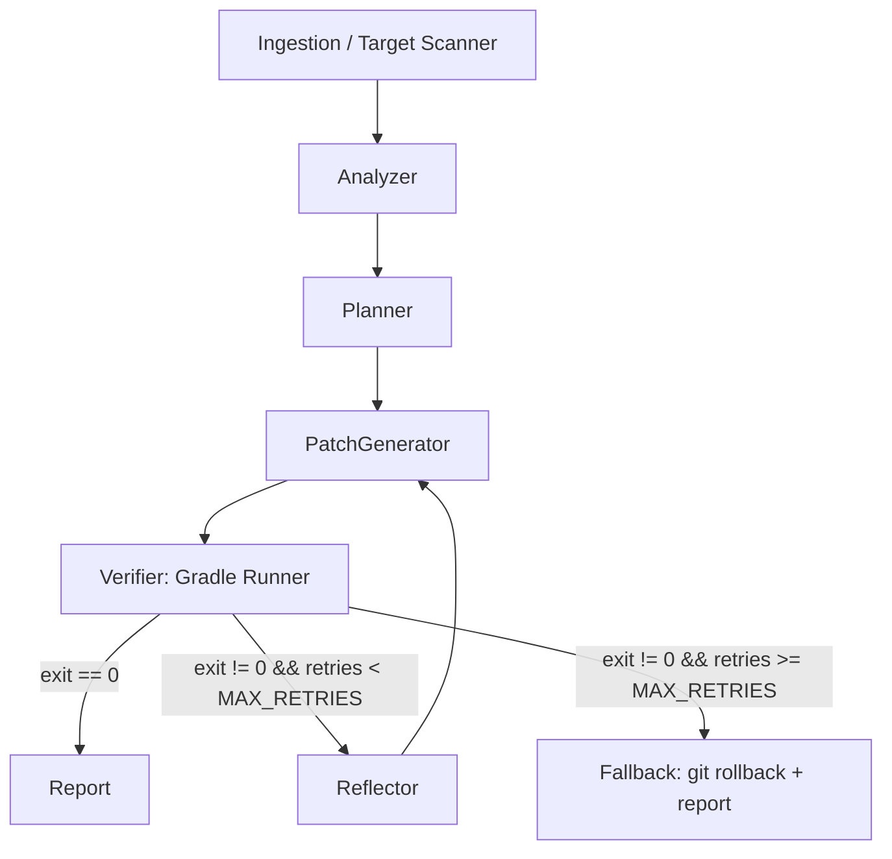

# GradleHealer

Autonomous Python agent built on LangGraph. It analyzes legacy Kotlin/Android code, generates unit tests (MockK, kotlinx-coroutines-test, Turbine) and performs refactorings with self-healing verified through Gradle.

## Core principle

**Generation is probabilistic, verification is deterministic.**
The agent does not infer the outcome of a build: it delegates it to the real compiler and Gradle. Every LLM output remains a hypothesis until `./gradlew` returns exit code 0.

## Stack

- **Runtime**: Python 3.12+, asynchronous (`asyncio`, `asyncio.create_subprocess_exec`)
- **Agent**: LangGraph (`StateGraph`, conditional edges, reflection loop, checkpointing)
- **Contracts**: Pydantic V2 for typed payloads and validated structured output
- **Target**: multi-module Android/Kotlin projects with Gradle (Kotlin DSL)
- **Observability**: Langfuse (per-node tracing, token usage, pass@k), from Sprint 4
- **Quality**: `uv`, Ruff (lint + format), mypy strict, pytest + pytest-asyncio

## Structure

```text
gradle-healer/
├── AGENTS.md
├── CLAUDE.md                # imports AGENTS.md
├── pyproject.toml
├── src/gradle_healer/
│   ├── __init__.py
│   ├── cli.py               # Typer entry point (Sprint 4)
│   ├── core/                # schemas.py, state.py, config.py
│   ├── tools/               # gradle_runner.py, log_parser.py, git_helpers.py
│   ├── graph/               # nodes, routing, graph builder
│   └── prompts/             # versioned prompt templates
├── tests/                   # offline unit tests (fakes/fixtures)
└── evals/                   # Kotlin fixture projects with intentional bugs + benchmarks
```

## Graph



1. **Ingestion**: locates the target class, the Gradle module it belongs to and its source sets.
2. **Analyzer**: extracts signatures, constructors, injected dependencies, coroutines/Flows and produces the minimal semantic context.
3. **Planner**: produces a structured plan (Pydantic schema) with the test cases or refactorings to apply.
4. **PatchGenerator**: generates the Kotlin code and writes it into the module's test source set, resolved from the module configuration rather than hardcoded (`src/test/kotlin` or `src/test/java`).
5. **Verifier**: runs the module's test task in an async subprocess with `--no-daemon --stacktrace` and captures stdout, stderr and exit code.
   - Android module: `:<module>:testDebugUnitTest`
   - Pure JVM module: `:<module>:test`
   - The task must therefore be parameterized, not hardcoded.
6. **Routing**: the `retries` counter lives in `AgentState` and is incremented by the Reflector.
7. **Reflector**: isolates the salient error, prunes build noise and produces targeted feedback for the PatchGenerator, including the previous diff.

## Engineering rules

1. **Typed contracts.** Every hand-off between nodes uses Pydantic models defined in `core/schemas.py`. No untyped dicts in the state, and LLM output is always validated against a schema.
2. **LLM / tool separation.** LLM nodes produce plans and patches; deterministic tools (Gradle, filesystem, git) execute and verify. No tool invokes the LLM.
3. **Context budget.** Never pass whole files or raw Gradle logs to the LLM. The log parser isolates only the salient error:
   - Kotlin compiler error `e: file:///…:line:col`
   - first exception
   - failed assertion

   It also truncates stack traces to the frames of the target package.
4. **Robust subprocesses.** Every Gradle invocation has:
   - an explicit timeout;
   - a process-group kill on stall;
   - stdout and stderr captured separately;
   - stripping of ANSI codes and progress bars.
5. **Circuit breaker and destructive operations.** Beyond `MAX_RETRIES`, the fallback runs `git checkout` / `git clean` only on the files tracked in the state as modified by the agent. It never operates on paths outside that perimeter.
6. **Test isolation.**
   - `tests/` runs offline, with fakes and fixtures: no real LLM or Gradle.
   - Tests that run real Gradle, including `gradle_runner.py` in Sprint 1, are marked `@pytest.mark.integration` and excluded from the default run.
   - End-to-end benchmarks live in `evals/`.
7. **Style.**
   - Complete type hints.
   - `async` wherever there is I/O.
   - Pydantic models or dataclasses instead of tuples.
   - No `print`: use `logging`.

## Commands

```bash
uv sync                          # dependencies from the lockfile
uv run ruff check . --fix        # lint
uv run ruff format .             # format
uv run mypy src                  # strict type check
uv run pytest                    # unit tests (offline)
uv run pytest -m integration     # tests with real Gradle
```

## Roadmap

- [ ] **Sprint 1: CLI Tooling & Schemas.**
  - Repo setup (`uv`, Ruff, mypy).
  - `tools/gradle_runner.py`: timeout, stream sanitization, salient-error parser.
  - `core/schemas.py`: `TargetClassContext`, `CodePatchPlan`, `BuildResult`.
- [ ] **Sprint 2: LangGraph Core.**
  - `AgentState`.
  - Nodes `analyzer_node`, `planner_node`, `coder_node`, `verifier_node`.
  - Linear pipeline: Ingestion → Analyzer → Planner → Coder → Verifier.
- [ ] **Sprint 3: Reflection & Self-Healing.**
  - `reflector_node` with a prompt specialized in Kotlin/MockK errors.
  - Conditional routing with `MAX_RETRIES`.
  - `fallback_node` with targeted git rollback.
- [ ] **Sprint 4: Evals, Tracing & Packaging.**
  - Langfuse on every node.
  - `evals/` + `run_benchmark.py`: pass@k, latency and cost per node.
  - Typer CLI.
  - README with Mermaid diagrams.

**Current sprint: 1**

## Working mode

- Proceed in small, verifiable increments: implement, run ruff + mypy + pytest and fix before moving on.
- Ask for confirmation before adding a dependency or changing a contract in `core/schemas.py`.
- If a detail about a Gradle module, the JVM toolchain or the target project configuration is ambiguous, ask specific questions instead of assuming.
- Propose ticking off a deliverable only with ruff, mypy and pytest green. Advance "Current sprint" only after my explicit confirmation.
- Work on the current sprint's branch (`sprintN`). Do not commit or push to `main`: it is reached only through a PR at the end of the sprint.
- Do not add progress logs, session notes or TODOs to this file: history lives in the commits.
