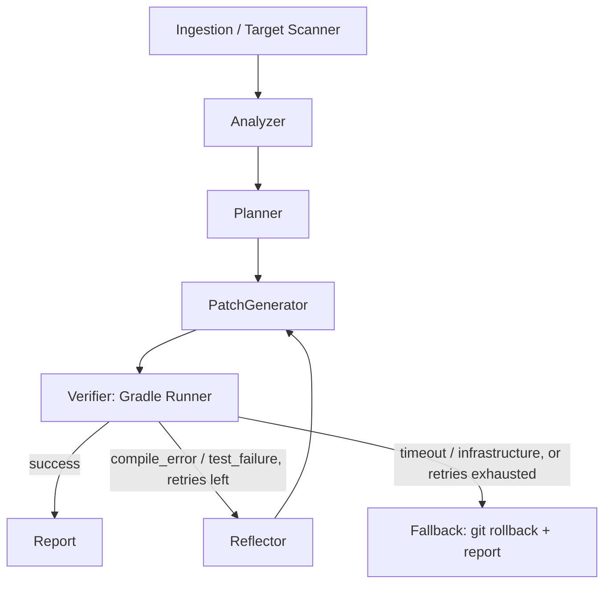

# GradleHealer

[](https://github.com/Brg92/gradle-healer/actions/workflows/ci.yml)
[](#supported-platforms)
[](LICENSE)

An autonomous agent being built to write unit tests for legacy Kotlin/Android
code and repair them until the real Gradle build passes.

## Table of contents

- [Overview](#overview)
- [Project status](#project-status)
- [Supported platforms](#supported-platforms)
- [Requirements](#requirements)
- [Installation](#installation)
- [Usage](#usage)
- [Configuration](#configuration)
- [How it works](#how-it-works)
- [Known limitations and troubleshooting](#known-limitations-and-troubleshooting)
- [Contributing](#contributing)
- [License](#license)

## Overview

GradleHealer is being built as a Python agent on LangGraph. Given a class in a
multi-module Kotlin/Android Gradle project, it will analyze the class, plan a
set of test cases and generate unit tests with MockK, kotlinx-coroutines-test
and Turbine. It will then run the real build: when compilation or a test
fails, the build output will be parsed into a short, structured error and fed
back to the model, which will retry within a bounded budget. When the budget
runs out, the agent will roll back only the files it touched. Today only the
build verification layer exists; see [Project status](#project-status).

It is meant for Android and Kotlin teams that want test coverage on code
written before tests were a habit, without trusting a model's claim that the
tests "should pass".

**Core principle: generation is probabilistic, verification is deterministic.**
Every model output is a hypothesis until the Gradle wrapper (`gradlew` on Linux
and macOS, `gradlew.bat` on Windows) exits with code 0. The agent never guesses
the outcome of a build; it runs it.

## Project status

GradleHealer is in early development. The agent is being built sprint by
sprint, and each completed sprint is tagged as a release.

| Sprint | Scope | Status |
|---|---|---|
| 1 | CLI tooling and schemas: Gradle runner, log parser, data contracts | Done (v0.1.0) |
| 1.5 | Cross-platform: macOS and Windows | Done (v0.2.0) |
| 2 | LangGraph core: analyzer, planner, coder and verifier nodes | Next |
| 3 | Reflection and self-healing: reflector, retry routing, git rollback | Planned |
| 4 | Evals, tracing (Langfuse) and packaging (CLI) | Planned |

**Usable today:** the Python library that runs a Gradle task and turns its
output into structured errors:

- `run_gradle` (`gradle_healer.tools.gradle_runner`): runs one task through the
  project's wrapper with a timeout, kills the whole process tree on stall and
  returns the sanitized output.
- `parse_build` (`gradle_healer.tools.log_parser`): turns that raw output into a
  `BuildResult`, with no I/O.
- `check_build` (`gradle_healer.tools.build_check`): both steps in one call.

**Not available yet:** the end-to-end agent (no test generation, no
self-healing loop) and a command-line interface.

## Supported platforms

| Platform | Status |
|---|---|
| Linux | Supported, tested in CI |
| macOS | Supported, tested in CI |
| Windows | Supported, tested in CI |

## Requirements

- Python 3.12 or later.
- [uv](https://docs.astral.sh/uv/).
- The JDK that the target project's Gradle build needs. GradleHealer only
  launches the project's own Gradle wrapper (`gradlew` on Linux and macOS,
  `gradlew.bat` on Windows); the bundled sandbox project uses JDK 17.

## Installation

GradleHealer is not published on PyPI. Install it from source:

```bash
git clone https://github.com/Brg92/gradle-healer.git
cd gradle-healer
uv sync
```

## Usage

Save this as `check.py` to run a test task and print what failed:

```python
import asyncio
import sys
from pathlib import Path

from gradle_healer.tools.build_check import check_build


async def main(project_dir: Path) -> None:
    result = await check_build(
        project_dir,
        ":core:test",
        target_package="com.example.sandbox",
        timeout_seconds=600,
    )
    if result.success:
        print(f"{result.task} passed in {result.duration_seconds:.0f}s")
        return

    print(f"{result.failure_kind} in {result.failed_task or result.task}")
    if result.summary:
        print(f"  {result.summary}")
    for error in result.errors:
        marker = "*" if error.is_primary else "-"
        where = f"{error.location.file}:{error.location.line}" if error.location else "?"
        print(f"{marker} [{error.kind}] {where} {error.message}")


asyncio.run(main(Path(sys.argv[1])))
```

Run it from the repository against a Gradle project, for example a copy of the
bundled sandbox with the `compile_error` scenario applied (see
[`evals/fixtures/scenarios`](evals/fixtures/scenarios/README.md)):

```bash
uv run python check.py path/to/sandbox-copy
```

```text
compile_error in :core:compileTestKotlin
* [compilation] core/src/test/kotlin/com/example/sandbox/BrokenTest.kt:11 Unresolved reference 'UserService'.
- [compilation] core/src/test/kotlin/com/example/sandbox/BrokenTest.kt:11 Cannot infer type for type parameter 'T'. Specify it explicitly.
- [compilation] core/src/test/kotlin/com/example/sandbox/BrokenTest.kt:18 Argument type mismatch: actual type is 'Int', but 'String' was expected.
```

With the `assertion_failure` scenario instead:

```text
test_failure in :core:test
* [test_failure] core/src/test/kotlin/com/example/sandbox/GetUserUseCaseFailingTest.kt:20 expected: <Grace> but was: <Ada>
```

On an unmodified copy it prints `:core:test passed in 4s`.

Use `:<module>:test` for a pure JVM module and `:<module>:testDebugUnitTest` for
an Android module. `target_package` is the package of the code under test: it
selects which stack trace frames are kept.

### Reading a `BuildResult`

- `success` is true only when Gradle exited with 0 within the timeout.
- `failure_kind` is `compile_error`, `test_failure`, `timeout` or
  `infrastructure` (Gradle could not start, the wrapper is missing, the daemon
  crashed or the output was not recognized). Compile errors and test failures
  both exit with code 1, so use this field rather than `exit_code`.
- `errors` holds a few `CompilationError` or `FailedTestError` entries, told
  apart by `kind`; when there are any, exactly one has `is_primary` set and is
  the one to fix first. Locations are relative to the project root and use
  forward slashes (`/`) on every platform.
- `failed_task` is the Gradle task that failed, e.g. `:core:compileTestKotlin`.
- `summary` is a one-line description, set for `timeout` and `infrastructure`
  and when a failure has no individual errors to report.
- `stdout` and `stderr` hold the full sanitized output, for logging only.

Invalid arguments (a malformed task path or package name) raise `ValueError`
before Gradle starts; every build outcome, including timeouts, is returned as
data.

## Configuration

There is nothing to configure yet: every option is a function argument.
Configuration will arrive with the command-line interface.

## How it works

The planned agent is a graph of nodes:



Only errors a model can fix (`compile_error`, `test_failure`) go back through
the Reflector; timeouts and infrastructure failures go straight to the
fallback.

The Verifier is the part that exists today, in two steps:

1. `run_gradle` runs `gradlew <task> --console=plain --no-daemon` (`gradlew.bat`
   on Windows) inside an isolated process tree (a POSIX process group on Linux
   and macOS, or a Job Object on Windows), kills the whole tree on timeout or
   cancellation, and returns a `RunOutcome`: exit code, timeout flag, duration,
   and stdout/stderr with ANSI codes and progress bars stripped.
2. `parse_build` turns the `RunOutcome` into a `BuildResult`: it classifies the
   failure, extracts Kotlin compiler errors (`e: file:///…:line:col`) and failed
   tests (first exception, expected/actual values), and keeps only the stack
   frames of the target package.

## Known limitations and troubleshooting

- **Windows has no graceful stop.** On timeout or cancellation the whole process
  tree is terminated immediately through the Job Object. Linux and macOS send
  `SIGTERM`, wait a grace period, then `SIGKILL` the process group.
- **Test details come from the console.** Failed tests are read from Gradle's
  console output, which includes messages and stack traces only when the
  project sets `testLogging { exceptionFormat = FULL }`. Projects that don't,
  including most Android projects, report only "N tests completed, M failed",
  and the result is a `test_failure` with no individual errors. Reading the
  JUnit XML reports is not implemented yet.
- **Java compiler errors are not parsed.** Only Kotlin compiler errors are
  extracted; a failing `javac` task is reported as `compile_error` without
  individual errors.
- **The first run is slow.** Each call starts Gradle without a daemon, and a
  cold build also downloads Gradle and the dependencies: allow several minutes
  and set `timeout_seconds` accordingly (in CI, the sandbox's cold build takes
  about two minutes on Linux and macOS, and about four minutes on Windows).
- **`infrastructure` with `"gradlew not found in project directory"` (Linux and
  macOS) or `"gradlew.bat not found in project directory"` (Windows)**: pass the
  Gradle root directory, the one that contains `gradlew` (`gradlew.bat` on
  Windows), not a module directory.

## Contributing

See [CONTRIBUTING.md](CONTRIBUTING.md).

## License

Apache License 2.0. See [LICENSE](LICENSE).
