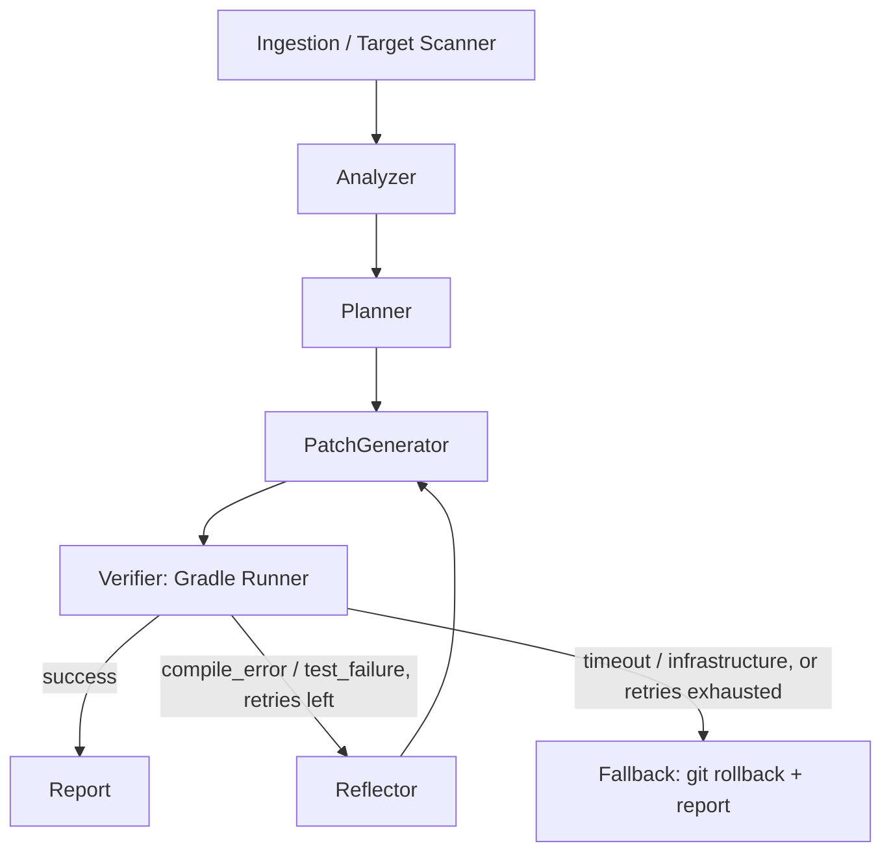

# GradleHealer

[](https://github.com/Brg92/gradle-healer/actions/workflows/ci.yml)

GradleHealer is an autonomous Python agent, built on LangGraph, that analyzes
legacy Kotlin/Android code, generates unit tests (MockK,
kotlinx-coroutines-test, Turbine) and repairs them until the real Gradle build
passes. Failed builds are parsed into short, structured errors and fed back to
the model, which retries within a bounded budget; when the budget runs out, the
agent rolls back only the files it touched.

**Core principle: generation is probabilistic, verification is deterministic.**
Every LLM output is a hypothesis until `./gradlew` says otherwise: the agent
never guesses the outcome of a build, it runs it.

## Architecture



The Verifier routes on `BuildResult.failure_kind`, not on the raw exit code:
only errors the model can fix go back through the Reflector.

| Exists today (Sprint 1) | Planned |
|---|---|
| `core/schemas.py`: `BuildResult`, `TargetClassContext`, `CodePatchPlan` | **Sprint 2**: `AgentState`, graph nodes, linear pipeline, tree-sitter-kotlin Analyzer |
| `core/validation.py`: plan vs. context cross-checks | **Sprint 3**: Reflector, conditional routing with `MAX_RETRIES`, Fallback with targeted git rollback |
| `tools/gradle_runner.py`: async runner, timeout, process-group kill, output sanitization | **Sprint 4**: Langfuse tracing, `evals/` benchmarks (pass@k, latency, cost), Typer CLI |
| `tools/log_parser.py`: raw output to `BuildResult` | |
| `tools/build_check.py`: runner + parser glue | |
| `evals/fixtures/sandbox-jvm` + failure scenarios | |
| Recorded Gradle logs in `tests/fixtures/logs` | |

## Requirements

- Linux or macOS (the runner kills process groups with `os.killpg`).
- Python 3.12 and [uv](https://docs.astral.sh/uv/).
- JDK 17, only for integration tests. The sandbox resolves its toolchain
  through the foojay resolver.

## Commands

```bash
uv sync                                               # install from the lockfile
uv run ruff check .                                   # lint
uv run ruff format --check .                          # format check
uv run mypy src tests                                 # strict type check
uv run pytest                                         # offline unit tests
uv run pytest -m integration                          # real Gradle on the sandbox
GRADLE_HEALER_RECORD_LOGS=1 uv run pytest -m integration  # re-record tests/fixtures/logs
uv run pre-commit install                             # install the git hooks
uv run pre-commit run --all-files                     # run every hook once
```

## Project layout

```text
gradle-healer/
├── AGENTS.md                # rules for coding agents (CLAUDE.md imports it)
├── pyproject.toml
├── src/gradle_healer/
│   ├── core/                # schemas.py, validation.py
│   ├── tools/               # gradle_runner.py, log_parser.py, build_check.py
│   ├── graph/               # Sprint 2
│   └── prompts/             # Sprint 2
├── tests/
│   ├── core/                # schema and validation tests
│   ├── tools/               # runner, parser, build_check; sandbox helpers
│   └── fixtures/logs/       # recorded Gradle stdout/stderr
└── evals/fixtures/
    ├── sandbox-jvm/         # Kotlin/JVM Gradle project, green by default
    └── scenarios/           # test files that break it on purpose
```

## Contributing

- All repository artifacts (code, comments, docs, commit messages) are in English.
- Commits follow [Conventional Commits](https://www.conventionalcommits.org/).
- Each sprint lives on its own branch (`sprintN`) and reaches `main` through a
  squash-merged pull request.
- Run `uv run pre-commit install` once; never bypass the hooks with `--no-verify`.

### Workaround policy

Targeted handling of a specific, expected exception (for example
`contextlib.suppress(ProcessLookupError)` around `os.killpg`) is normal code.
The following need explicit approval and a comment explaining why:

- `# type: ignore`, `# noqa`, `# pragma`;
- broad `except` or `suppress` (`Exception`, `BaseException`, bare `except`);
- suppressed warnings;
- sleep-based synchronization;
- configuration changes made only to silence a tool.

Approved so far:

| Location | Workaround | Reason |
|---|---|---|
| `tests/core/test_schemas.py` | `# type: ignore[misc]` | Asserts that a frozen model rejects assignment at runtime. |
| `tests/tools/sandbox.py` (`poll_until`) | `# noqa: ASYNC110` + bounded polling | Nothing signals when init reaps an orphaned process, so there is no event to wait on. |
